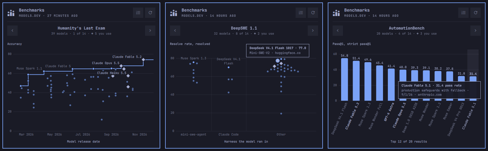

# Model benchmarks for Omarchy

An [Omarchy](https://omarchy.org) shell plugin: a bar icon that opens a panel of AI model benchmark scores, one benchmark at a time, as a graph or a list, with the models you use marked.



The scores are [models.dev](https://models.dev)'s (MIT), which records for each one the page it was taken from. The plugin only fetches, checks and shows them. It computes no ranking of its own: every reported result that can be compared is shown, best first, with the harness, settings and date it was reported with.

## Install

```bash
omarchy plugin add https://github.com/yamz8/omarchy-benchmarks-plugin.git --enable
```

It needs nothing beyond what Omarchy ships (`curl` and `jq`). Remove it with `omarchy plugin remove yamz8.benchmarks`.

## Using it

Click the podium icon in the bar, or bind a key to `omarchy-shell shell toggle yamz8.benchmarks`, which opens it on the display you are on.

| Key | Does |
|---|---|
| Left / Right | Previous / next benchmark |
| Up / Down | Move through the scores |
| V | Switch between the graph and the list |
| M | Jump to the next model you use |
| Enter | Open the selected score's source in the browser |
| R | Refetch now |
| Esc | Close |

Middle-click on the bar icon also refetches.

## Which benchmarks, and your models

The benchmarks on offer are the eight that the most models report, plus up to six that the models you use are on. No benchmark is named in the code: when one falls out of use and another takes over, the lists follow the data. Different versions of a benchmark (Terminal-Bench 2.1 and 4.0) are separate lists, since they are different tests.

The widest benchmarks are the long-established ones, and the newest models are often no longer reported on them, which is why yours get lists of their own. Those with more of your models come first, so the panel opens on the benchmark that says the most about what you run.

The models you use are the ones in the agents panel's usage records (`~/.local/state/omarchy/agents/usage/`), matched to models.dev by name. They are read when the panel opens and never leave the machine. On a graph they are diamonds in the text color with their names beside them; in the list they carry the same diamond; and the line under the benchmark's name says how many of them it has. M steps the cursor through them.

## Graph and list

The panel opens on a graph, and the graph's form follows how the benchmark is built. That is read off the benchmark's data, not its name:

- **Score over time.** Where each model has one score and the results reach back at least six months, every result is a dot at its model's release date, with a line along the best score so far and the record setters named.
- **A strip for each harness.** On an agent benchmark, where most results name the harness the model ran in, every result is a dot in its harness's strip, with the leader of each strip named. Up to three harnesses get a strip of their own, each with at least three results; everything else shares a wider one named Other. Scores compare fairly only within one harness, so that is how they are laid out.
- **Columns.** Where there is too little history for a line and no harness to split on, the top twelve results as columns measured from zero. Scores that are ratings rather than shares of a whole (Elo, in the thousands) are dots instead, since columns from zero would all look the same height.

Every graph names its axes, and no more than that:

- **Top left: what the scores are**, in the words their sources use for the metric (accuracy, resolve rate, Elo). Results on one benchmark don't always agree on the wording, so where no single one covers two thirds of them, the two commonest are named.
- **Along the bottom: what the other axis is**, where it needs saying. The model's release date, the harness the model ran in, or that only the top twelve results are on show. Models named under their own columns need no title.

On a graph over time, the line is the best score so far. A diamond is a model you use.

Point at a result, or step through them best first with Up and Down, and a card says which one it is and what its score was reported with, including its own metric where the benchmark's results name more than one. The card sits beside a dot, and at the foot of a column so that it covers no other column's score. Enter or a click opens its source, as in the list.

V switches to the list, which has every result with its details, for as long as the shell runs. To open on the list every time:

```bash
omarchy bar set yamz8.benchmarks view List
```

## Network

One request, to `https://models.dev/models.json`, and only when the panel is opened and the saved copy is more than a day old (or on R). Nothing runs while the panel is closed. The copy is kept in `~/.cache/yamz8.benchmarks/`; when the fetch fails, the saved copy stays on show and the panel says so.

## Reading the scores

Most are reported by the model's own maker, and the same model can score differently in different harnesses or at different effort settings, which is why those are on each row. Enter on a row shows where its number came from.

A result is left out only where ranking it with the rest would be wrong:

- **Another scale.** A win rate among Elo ratings, say.
- **A second metric for the same run.** Some models report one run under two metrics, such as OSWorld's partial score and its stricter completion rate. Those are two measurements, so they can't share an axis. The one more models report stays; where that is a tie, the one closer to the benchmark's other results does.
- **A metric that runs the other way.** A stray error rate on a benchmark scored by accuracy.

Where a benchmark's own metric says less is better (an edit distance, an error rate), the lowest score comes first, the line follows the lowest so far, and the graph's title says so. Nothing in the data says which way a metric runs, so this is read from a few words in its name, and any other metric is taken as higher is better.

## Tests

```bash
node --test tests/
```

The tests cover the data handling in `Model.js`: parsing and bounding the response, which benchmarks get a list, which form a graph takes, and the fetch script against a stand-in `curl`. None of them touch the network.

## License

MIT. The benchmark data belongs to [models.dev](https://github.com/anomalyco/models.dev) and the sources it cites.
